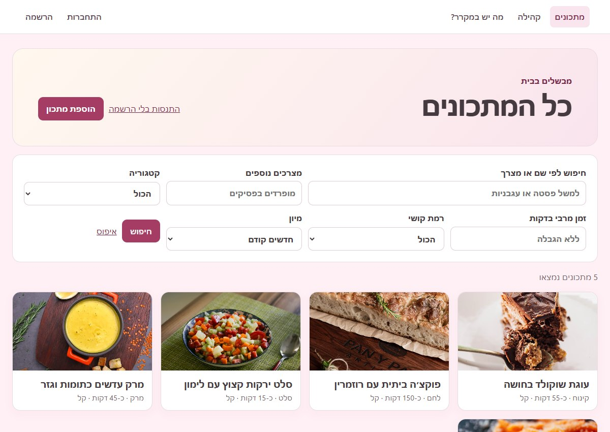
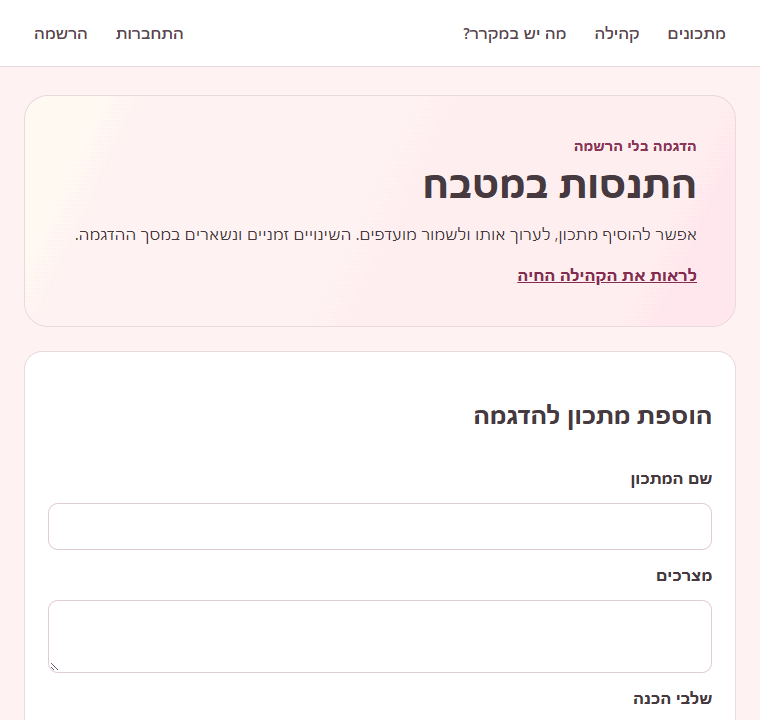
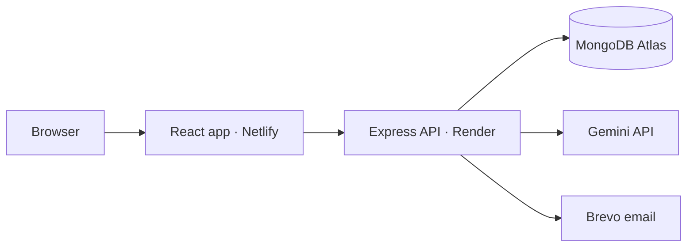

# Recipe Book

A Hebrew-language recipe sharing platform built by Maya Hod with React, Node.js, Express, and MongoDB. Browse public recipes, follow home cooks, and ask an AI cooking assistant what you can make with the ingredients you already have.

**[Live site](https://velvety-semolina-e365c7.netlify.app/)** · [Try without an account](https://velvety-semolina-e365c7.netlify.app/demo) · [Community](https://velvety-semolina-e365c7.netlify.app/community) · [Pantry assistant](https://velvety-semolina-e365c7.netlify.app/pantry) · [Architecture](docs/ARCHITECTURE.md) · [API reference](docs/API.md)



## Try it

- **Browse the recipe catalog.** Combine name, ingredient, category, time, and difficulty filters. Results are paginated and can be sorted by date, name, or preparation time. Featured recipes are bundled with the site so visitors can open them while the live catalog loads.
- **Try the demo.** Add and edit a sample recipe, save it to favorites, and view your saved recipes. Demo changes stay in the current page session.
- **Explore the community without signing up.** Open a labeled demo profile to see its public recipes. Sign in to follow creators, see their posts in your feed, and leave likes or comments.
- **Use what you have.** Find public recipes ranked by matching ingredients, or ask the pantry assistant for an original suggestion with an estimated cooking time and instructions.



## What I built

- **Recipe management.** A personal dashboard for creating, editing, deleting, and publishing recipes. New recipes start private, and a photo and preparation time are optional.
- **Accounts and permissions.** Registration, sign-in, and email-based password reset. The API checks ownership on private reads and edits. Reset links expire after 30 minutes and can only be used once.
- **Community features.** Searchable usernames, profile photos, following, a personalized feed, public discovery, and discussions. MongoDB updates keep a like unique per user and a follow unique per account pair.
- **Pantry chat.** The Express API validates conversation turns, limits requests, and calls Gemini using a server-side key. The React interface renders headings, lists, and emphasis in its replies.
- **Saved recipes and meal planning.** Members can save recipes to favorites or named collections. The weekly planner combines compatible quantities into a shopping list and stores the plan in the current browser.
- **Testing and delivery.** GitHub Actions runs formatting, lint, unit tests, a production build, integration tests against a disposable MongoDB instance, and Playwright browser tests. Netlify serves the frontend, and Render runs the API.

The project started from a QueenB starter template.

## How it fits together



The static frontend can open independently of the API. Live data and signed-in actions can take longer on the first request if the free Render service is waking up. The [architecture notes](docs/ARCHITECTURE.md) explain the tradeoffs around session storage, recipe privacy, and hosting. The [deployment guide](DEPLOYMENT.md) covers hosting and provider configuration.

## Run locally

Use Node.js 22, npm, and a MongoDB instance.

```sh
git clone https://github.com/mayahod/my-fullstack-app.git
cd my-fullstack-app
npm ci --prefix server
npm ci --prefix client
```

Copy [server/.env.example](server/.env.example) to `server/.env` and set `MONGO_URI` and a random `JWT_SECRET`. Configure `GEMINI_API_KEY` for live chat and the email settings for password-reset delivery. Both integrations are optional for local browsing and recipe management.

Run `npm run dev:server` and `npm run dev:client` in separate terminals, then open the address printed by Vite. By default, Vite serves port 3002 and proxies `/api` to port 5001. Keep provider keys in server environment variables.

## Verify

| Command                    | What it checks                                                                                                        |
| -------------------------- | --------------------------------------------------------------------------------------------------------------------- |
| `npm run check`            | Formatting, lint, unit tests, and the frontend build                                                                  |
| `npm run test:integration` | Account and session flows, recipe permissions, community interactions, password resets, and pantry request validation |
| `npm run test:e2e`         | Browser flows for the demo, login, search, saving a recipe, meal planning, and pantry matches                         |

Integration tests need `MONGO_URI` and `JWT_SECRET`. Use a dedicated test database. The suite stubs external email and AI calls, and CI uses a temporary MongoDB service.

For browser tests, run `npm ci` from the root, install Chromium with `npx playwright install chromium`, and build the client with `npm run build --prefix client`. The browser tests use `E2E_MONGO_URI` or a separate local database named `recipes_e2e`.

[Photo credits](client/public/images/photo-credits.json)
